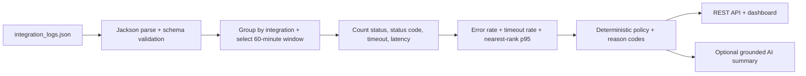

# SOLUTION_DESIGN: API Integration Health (aligned to integration_logs.json)

## 1. Actual dataset profile

The supplied JSON has a top-level `logs` array. Each event contains `integration`, ISO local `timestamp`, `status`,
nullable `status_code`, and `latency_ms`. There is no request ID or tenant field. The file contains five integrations
sampled every five minutes from 09:00 through 09:55, giving 12 observations per integration. Evaluation is anchored to
the latest timestamp (09:55) for repeatable replay.

## 2. Observed baseline

| Integration            | Failures | Error rate | Timeouts | p95 ms | HTTP pattern                    | Proposed status |
|------------------------|---------:|-----------:|---------:|-------:|---------------------------------|-----------------|
| Slack Notifications    |     1/12 |       8.3% |        0 |    310 | {'200': 11, '500': 1}           | HEALTHY         |
| ADP Payroll Sync       |     5/12 |      41.7% |        0 |    430 | {'200': 7, '500': 5}            | UNHEALTHY       |
| DocuSign Envelope API  |     4/12 |      33.3% |        0 |    900 | {'200': 8, '429': 4}            | UNHEALTHY       |
| Workday Directory Sync |     1/12 |       8.3% |        0 |    280 | {'200': 11, '503': 1}           | HEALTHY         |
| Greenhouse ATS Sync    |     6/12 |      50.0% |        5 |  30000 | {'200': 6, 'None': 5, '500': 1} | UNHEALTHY       |

## 3. Dataset-calibrated policy

- Window: 60 minutes, because the provided file has one observation every five minutes and 12 samples per integration.
- Minimum volume: 6 observations. The previous value of 20 is not usable for this file.
- DEGRADED: failure rate >= 10%, timeout rate >= 10%, or p95 >= 1,000 ms.
- UNHEALTHY: failure rate >= 30%, timeout rate >= 25%, or p95 >= 5,000 ms.
- HEALTHY: below all warning thresholds. NO_DATA remains a distinct state for stale/missing observations.
- `timeout` is a failure even when `status_code` is null. HTTP 429, 500 and 503 remain separate evidence for
  investigation.

## 4. Flow

## 5. Implementation changes

- Replace CSV ingestion with `JsonLogRepository` using Jackson/ObjectMapper.
- Use `LocalDateTime` because the timestamps contain no UTC offset. Do not silently assume a timezone.
- Remove request-ID deduplication because the source has no request identifier.
- Add `timeoutCount`, `timeoutRate`, and `statusCodeCounts` to the API result.
- Make status matching case-insensitive and treat every non-success status as a failure.

## 6. AI enhancement

The model receives only the verified health snapshot: integration name, status, failure/timeout rates, p95, status-code
counts, thresholds and reason codes. It may describe patterns such as repeated 429 responses or timeouts, but it must
not assert a root cause. The deterministic fallback remains the default so the solution runs without credentials.

## 7. Trade-offs and next steps

This file is sparse synthetic monitoring data, not high-volume request logs. Percentages move in 8.33-point increments,
so every single event materially changes the rate. The chosen thresholds are demonstration defaults. Production should
ingest true request-level logs, use per-integration SLOs, calibrate against incidents, preserve timezone/offset, add
request IDs, and use consecutive windows before paging.